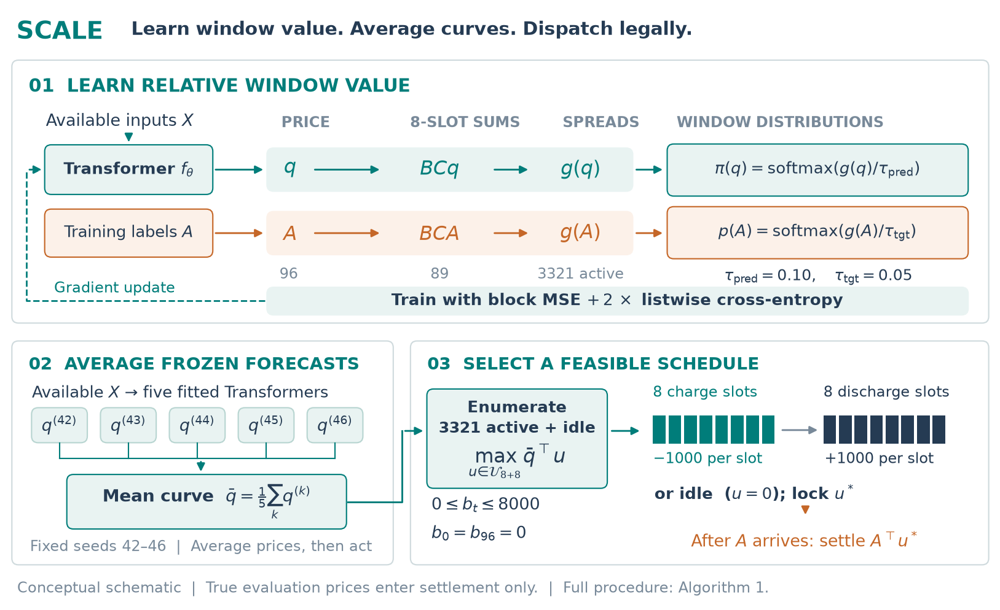

# Decision-Focused ML for Electricity Storage Arbitrage

Yukai Song · independent research, May–September 2026

This repository studies a constrained electricity-storage decision: given a day-ahead forecast of a 96-point price curve, choose one feasible charge/discharge schedule, then settle that locked schedule on the realized curve. The research question is whether lower pointwise forecast error produces a higher dispatch score.

The recorded answer, on one historically exposed 59-day window, is no. A contextual Transformer with lower RMSE realized a lower raw dispatch score than a worse point forecast from a different fitting recipe. The implemented response is to train on the window values the scheduler actually reads, average five fixed-seed price curves, and enumerate the legal schedules exactly.

Scores below are the project's raw price–power score, `sum(price × coded power)`. They are not currency, not a trading return, and not a live-trading result.

## 1. Research question

Pointwise error charges every deviation on the price curve. The scheduler only compares feasible window spreads. Those two criteria need not rank the same fitted models.

On the same 59 days and the same action set, two saved contextual Transformer curves disagree:

| Saved candidate | RMSE (lower is better) | Mean raw dispatch score (higher is better) |
| :-- | --: | --: |
| v1 contextual Transformer | 0.519558 | 5,637.17 |
| v2 contextual Transformer | 0.682788 | 6,214.36 |

The lower-RMSE curve does not win. The two curves come from different fitting recipes, so this is a counterexample to ranking these candidates by RMSE, not a controlled causal experiment on one hyperparameter.

The geometry explains how that can happen. Every active schedule in the contract charges and discharges the same coded energy, so a common price offset changes RMSE and cancels in the dispatch score. Action choice depends on relative window values. The English report states the corresponding regret bound and the population boundary: under ideal squared-error assumptions the conditional mean remains optimal for a risk-neutral linear score. The practical question is how to train and evaluate a restricted model on a finite sample.

## 2. Data and information availability

The price series comes from the [AI4S competition, race 9](https://competition.ai4s.com.cn/race/9/description). The problem statement describes an anonymized, rescaled node in the Mengxi region. In the files the node is only the column `A`. Values are not physical units and not currency. This repository does not identify a market participant, a settlement point, or a financial instrument, and it does not redistribute the competition data.

Forecast boundary channels are legitimate decision-time inputs only if the full boundary curve was published before the decision. The files do not establish that publication contract.

| Role | Dates | Use |
| :-- | :-- | :-- |
| Inner fit | 2 Jan–3 Oct 2025, 271 complete days | Fit candidates |
| Validation | 4 Oct–2 Nov 2025, 30 days | Choose recipe and epoch |
| Final development refit | 2 Jan–2 Nov 2025, 301 days | Refit each frozen seed |
| Evaluation | 3 Nov–31 Dec 2025, 59 days, 5,664 slots | Settle locked predictions |

The 59-day window was already inspected during earlier candidate comparisons. The final ensemble recipe was frozen before ensemble scoring. It is a historically exposed evaluation window, not an untouched holdout. Details and the path layout are in [DATA.md](DATA.md).

What can be reproduced from this repository:

| Layer | What it shows | Needs the raw series? |
| :-- | :-- | :-- |
| Summary records and the English report | Recorded scores, intervals, figures, and tables | No |
| Synthetic demo | Scheduler, constraints, and settlement arithmetic on a made-up curve | No |
| Full forecasting and decision-focused training | The original experiments | Yes. Not included here |

## 3. Forecasting and decision-focused learning

The headline feature set has 67 contextual channels. Contemporaneous realized boundary columns and the target `A` are excluded from the forecast. Feature construction and the day split are in [`src/phase_b/features.py`](src/phase_b/features.py) and [`src/phase_b/splits.py`](src/phase_b/splits.py). Column names in the loader match the competition CSVs; English names are used after that map.

A 96-point forecast is turned into 89 overlapping eight-slot block sums and 3,321 charge/discharge spreads. Training uses day-centered block regression plus a listwise soft target over those window values ([`experiments/holdout_dfl_ltr_v1/loss.py`](experiments/holdout_dfl_ltr_v1/loss.py)). The frozen recipe is a contextual Transformer with `λ = 2`, target temperature `0.05`, prediction temperature `0.10`, 13 epochs, and learning rate `10⁻³`.

Other decision-focused losses (hard window cross-entropy, pairwise differences, SPO+, a differentiable black-box pass, and a cheap pinball control) were run as comparisons. They are not re-ranked here. The pre-registered headline is the listwise Transformer, not whichever exploratory run scored highest.

Five seeds, 42 through 46, are refit under that frozen recipe. Their price curves are averaged first; the exact scheduler then sees one curve ([`experiments/holdout_seed_bag_v1/run.py`](experiments/holdout_seed_bag_v1/run.py), [`combine.py`](experiments/holdout_seed_bag_v1/combine.py)). Averaging prices and then optimizing returns one legal schedule. Averaging the discrete actions need not.



## 4. Storage constraints and dispatch

Each day has 96 slots of 15 minutes. An active schedule charges at coded power −1000 for eight consecutive slots, then discharges at +1000 for eight later slots. There are 3,321 such windows, plus idle. The solver enumerates all of them ([`src/phase_b/dispatch.py`](src/phase_b/dispatch.py)). Near-ties use a deterministic earliest-window rule. Idle wins when its score is at least as high as the best active score. Legality is checked in [`src/phase_b/contracts.py`](src/phase_b/contracts.py).

Within this discrete contract the action family implies a task-unit storage path that starts at 0, peaks at 8,000, and ends at 0, with charge completed before discharge. That is not a physical battery model. Round-trip efficiency, degradation, cycling costs, network limits, and a state-of-charge band are not in the solver. Equal charge and discharge blocks do not restore a physical state of charge once efficiency is below one. The English report gives an illustrative case in which the same 8+8 pattern violates a 90% state-of-charge bound.

Realized evaluation prices are used only after the action is locked. The oracle is the same solver run on the realized prices: the perfect-information upper bound under the same constraints, not a tradable benchmark.

## 5. Historical results and risk analysis

All figures in this section are the recorded 59-day evaluation. They were not retrained or reselected for this repository.

| Method | Mean raw dispatch score | Aggregate fraction of the same-constraint oracle |
| :-- | --: | --: |
| Project LightGBM baseline | 5,786.10 | 64.28% |
| Project MSE Transformer reference | 6,214.36 | 69.04% |
| Listwise Transformer, five-seed curve mean | **6,693.88** | **74.37%** |
| Perfect-information oracle | 9,000.89 | 100.00% |

The observed mean increase over the MSE Transformer reference is 479.51, which is 7.72% of that reference score. That percentage is a raw dispatch-score difference. It is not a rate of return. Aggregate capture is total realized score divided by total oracle score, not the average of daily ratios.

The gain is concentrated and the uncertainty interval crosses zero:

- 86.0% of the net increase falls on one day.
- The paired seven-day-block 95% conditional resampling interval for the score difference is [−227.87, 1,626.28].
- The worst day is −5,922.66 for the listwise ensemble and −2,340.48 for the MSE Transformer reference.
- The interval resamples dates only. It holds the candidate set and the training randomness fixed. It is not a claim of coverage for a future period.

These records support an observed improvement on this window. They do not establish a stable advantage on a new period, an improvement in tail risk, or an isolated causal effect of the loss. A matched-initialization control moved one LSTM by 137.79, on the order of a stage-level gap, so initialization is a first-order effect.

An independent replay of 62 saved curves × 59 days (3,658 daily decisions) found no action mismatches and settlement agreement within 1.5 × 10⁻¹¹. That checks the implementation against the frozen records. It does not certify future performance. The audit narrative is in [AUDIT.md](AUDIT.md); the machine-readable comparisons are in [`audit_records/`](audit_records/).

The English report snapshot is [report/pdf/dispatch_value_report_en.pdf](report/pdf/dispatch_value_report_en.pdf) (18 pages, 15 September 2026 evidence review). It is the reproducibility snapshot that the build tools regenerate. It still uses broad wording on capacity and market origin; read it with the two clarifications above: the 8+8 family meets the discrete 0–8,000 task-unit path, and the competition statement describes an anonymized Mengxi node. Efficiency, degradation, and cost are still unmodeled.

## 6. Quickstart and reproducibility

Summary checks and the synthetic demo need only the scientific Python stack:

```bash
python -m pip install -r requirements.txt
python examples/synthetic_dispatch_demo.py
python tools/check_numbers.py
python tools/verify_reproduction.py
```

`examples/synthetic_dispatch_demo.py` builds a fake 96-point curve, runs the exact scheduler, checks the contract, and settles the chosen schedule. It is labeled synthetic. It does not reproduce 6,693.88 or 7.72%.

`tools/check_numbers.py` traces decimals in the English report to `report/shared/data/`. `tools/verify_reproduction.py` redraws the six figures and seven tables from those records. Recompiling the PDF also needs Tectonic or XeLaTeX plus `latexmk`:

```bash
python tools/build_report.py
```

The full training stack is `requirements-full.txt`, and it still requires the competition files listed in [DATA.md](DATA.md). Cloning this repository does not replay the 62 curves. Torch results are not guaranteed to be bit-identical across platforms. Tree and linear candidates were deterministic on the recorded platform.

Notebooks `notebooks/11`–`14` document the exploratory path from the RMSE mismatch to the five-seed curve average. Their stored outputs were removed because the executed charts used Chinese labels and cannot be redrawn without the raw series. The numbers in the notebook text are the recorded results.

## Layout

| Path | Role |
| :-- | :-- |
| `src/phase_b/` | Features, splits, forecasting helpers, exact dispatch, contract checks |
| `experiments/holdout_rmse_v1/`, `holdout_rmse_v2/` | Point-loss candidate panels |
| `experiments/holdout_dispatch_replay/` | Settlement replay and failure notes |
| `experiments/holdout_dispatch_loss_v1/`, `holdout_dfl_bakeoff_v1/`, `holdout_dfl_ltr_v1/` | Block-value and decision-focused losses |
| `experiments/holdout_seed_bag_v1/` | Frozen five-seed curve ensemble |
| `experiments/holdout_dispatch_loss_codex_v1/` | Matched-initialization control |
| `report/` | English report, figures, and aggregated records |
| `audit_records/` | Independent numeric checks |
| `tools/` | Report rebuild and number checks. No model is fit |

## License

Code and documentation are [MIT](LICENSE). Data rights stay with the competition organizers. Attribution, the limits on the reported gain, and the note on AI-assisted writing are in [NOTICE.md](NOTICE.md).
